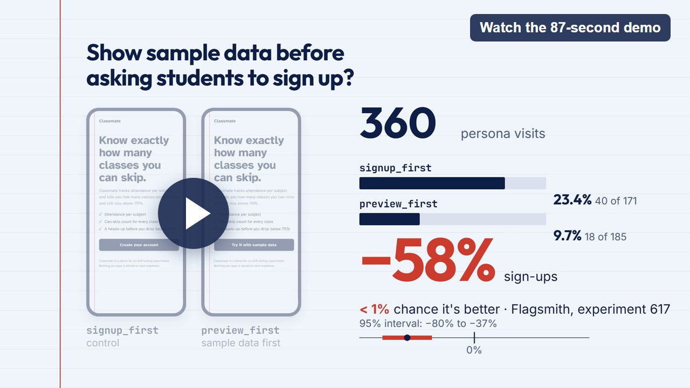
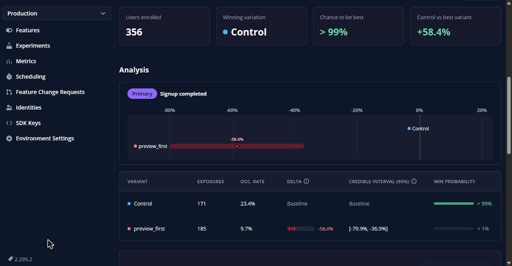
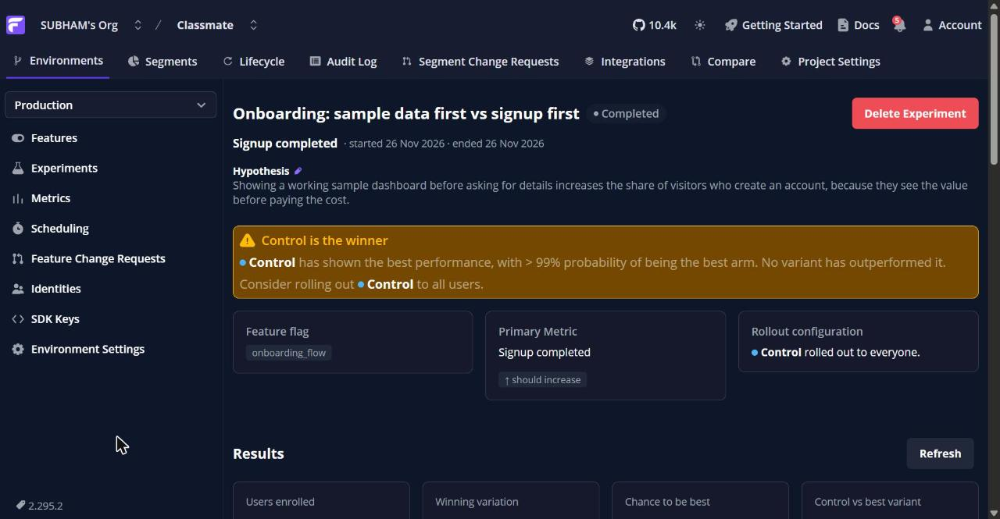

# Understudy

**Rehearse a Flagsmith experiment on AI personas before real traffic arrives.**

[](https://youtu.be/pZ6SbkKAjz0)

**▶ Demo video:** https://youtu.be/pZ6SbkKAjz0 · **Live page under test:** https://milkandvodka.github.io/understudy/ · **Full report:** [REPORT.md](REPORT.md)

**Result:** showing sample data before signup **cut sign-ups by 58%** (Flagsmith: 23.4% → 9.7%, 95% credible interval −80% to −37%, under 1% chance it beats control). The rule written before launch says keep control. Without Understudy, this would have been learned on real users.

## Why

The Toggle Wars brief says it plainly: *"You only have four days of data."* Most new features and small apps are in the same spot. There isn't enough traffic to learn anything in a few days, and the first real visitors are the ones who find the broken button.

Understudy is a dress rehearsal for a [Flagsmith Experimentation](https://docs.flagsmith.com/experimentation) test. AI personas open the real page in a real browser, Flagsmith splits them between variants, and the page's own SDK records every exposure and conversion. When real traffic arrives, the experiment has already been debugged, and you know what to watch for.

It works like this:

- **The result isn't hard-coded.** There are no conversion rates typed into a script. Each persona reads the page and decides what to do, one tap at a time.
- **The events are real.** Understudy never calls Flagsmith. All Flagsmith traffic comes from the page under test, exactly as it would for a human.
- **You get the *why*, not just the *what*.** Every session leaves a transcript with the persona's thoughts and why it left.

## Caught before launch

Understudy's first run found a real bug. In `src/style.css`, the rule `button { display: block }` beat the `hidden` attribute, so the "Create your account" button never disappeared after a tap. Every persona kept tapping it and never reached the form. It was fixed in [`1634250`](../../commit/1634250) before any experiment launched.

The first run on a real model found a second one. A persona typed their roll number as `22CS1047`, got *"Roll number is 6–10 digits"* three times, and left: *"Roll number field rejects my real ID with an unclear format rule… not worth the hassle."* Plenty of colleges put letters in roll numbers, so the rule now accepts 5–12 letters or digits.

The rehearsal (Understudy's own counts checked against Flagsmith's) found a third one, this time in Understudy itself. Flagsmith's exposures matched the transcripts exactly (33 and 28), but almost every conversion was missing. Each persona's browser was closing as soon as they signed up, while the `signup_completed` request was still in flight. The fix: a session now waits for the page's Flagsmith event requests to finish before it closes. Without that cross-check, the real experiment would have quietly undercounted every signup.

All three are the kind of mistake you want an understudy to hit instead of your first real visitors.

## The experiment

**Classmate** is a one-page student attendance app ("know exactly how many classes you can skip and stay above 75%"). It's the subject under test.

| | |
|---|---|
| **Decision it informs** | Should Classmate show a working sample dashboard before asking students to sign up? |
| **Hypothesis** | Showing a sample dashboard first increases the share of visitors who create an account, because they see the value before paying the cost. The risk: the extra step loses impatient visitors. |
| **Flag** | Multivariate `onboarding_flow`. Control `signup_first` goes straight to the signup form. Variation `preview_first` shows the sample dashboard, then the same form. |
| **Metric** | `signup_completed`, Occurrence, Up. It fires within the visit, as the brief recommends. |
| **Split** | 100% of visitors, 50/50 |
| **Decision rule** | Written down before launch in [`understudy/decision.json`](understudy/decision.json). Ship `preview_first` if Flagsmith's chance to beat control is above 95%. Keep control if it's below 5%. Otherwise the result is inconclusive: keep control and re-test on real traffic. |
| **Pre-registration** | Hypothesis, metric, decision rule, personas and prompt are frozen at git tag [`prereg`](../../tree/prereg) (`84763d0`), before launch. Changes after it were fixes to measurement and harness bugs only, each logged in its commit message. |

## How Flagsmith is used

All experiment wiring lives in [`src/experiment.js`](src/experiment.js), so it can be removed cleanly once the experiment ends.

| Step | Where |
|---|---|
| Identify the visitor (anonymous UUID in localStorage) and init with events on | [`src/main.js:17`](src/main.js#L17) |
| **Exposure:** `getExperimentFlag('onboarding_flow')` records which version this visitor saw | [`src/main.js:19`](src/main.js#L19) |
| Flush right away, so visitors who bounce in 3 seconds still count | [`src/main.js:20`](src/main.js#L20) |
| If Flagsmith hasn't answered within 4 s, show control and record **no** exposure, so nobody is counted in a version they didn't see | [`src/main.js:16`](src/main.js#L16), [`src/experiment.js:27`](src/experiment.js#L27) |
| **Conversion:** `trackEvent('signup_completed')` | [`src/main.js:69`](src/main.js#L69) |
| The decision rule applied in code, with the persona breakdown | [`understudy/report.js`](understudy/report.js) → [`REPORT.md`](REPORT.md) |
| Ship the winner with the same flag, then delete the losing code | _see "Shipping the winner"_ |

## How Understudy works

```
for each session:
  fresh browser context            → a brand-new visitor (localStorage id "us-<uuid>")
  open the page                    → Flagsmith assigns a variant and records exposure
  loop (≤ 12 steps):
    snapshot: page text + numbered buttons and fields
    ask the model, as the persona  → {"thought", "action": click | type | leave, ...}
    act in the browser             → conversion fires if the persona signs up
  write the transcript             → runs/<run>.jsonl
```

- **Personas** ([`understudy/personas.json`](understudy/personas.json)): 10 students, from an anxious first-year to someone who once got spammed by a "free" app. They're written in second person and say nothing about either version.
- **Model:** every persona runs on `deepseek-v4.1-flash:cloud` through Ollama Cloud. It's pinned in [`understudy/agent.js`](understudy/agent.js) and checked by a test, so all sessions in an experiment use exactly the same model.
- **Robust to messy model output:** JSON inside fences or chatter is parsed, invalid actions are recorded and skipped, and three invalid actions in a row end the session as an error. See [`understudy/actions.js`](understudy/actions.js).
- **Agent identities are prefixed `us-`**, so they're easy to tell apart from humans in Flagsmith.

## Run it

```bash
npm ci
npx playwright install chromium
cp .env.example .env    # VITE_FLAGSMITH_ENV_ID (client-side key) + OLLAMA_API_KEY
npm test                # 20 tests
npm run dev             # Classmate on http://localhost:5173
npm run understudy -- --sessions 20 --url http://localhost:5173            # rehearse
npm run understudy -- --sessions 2 --url http://localhost:5173 --headed    # watch them
```

In Flagsmith, create a multivariate flag `onboarding_flow` with value `signup_first` and a variation `preview_first`, plus a metric on the event `signup_completed`. Then start an experiment on the flag. See the [Flagsmith Experimentation docs](https://docs.flagsmith.com/experimentation).

## Results

Production experiment 617, 360 persona visits in three waves of 120 (DeepSeek V4.1 Flash). Numbers are from Flagsmith's dashboard; [`REPORT.md`](REPORT.md) is generated by `npm run report`.

| Variant | Visitors (Flagsmith) | Sign-ups | Rate |
|---|---|---|---|
| `signup_first` (control) | 171 | 40 | **23.4%** |
| `preview_first` | 185 | 18 | **9.7%** |



- **What Flagsmith says:** preview_first changed sign-ups by **−58.4%**, with a 95% credible interval of **−79.9% to −36.9%**. Even the most optimistic plausible value is a big drop. Chance that preview_first beats control: **< 1%**.
- **What the pre-registered rule says:** below 5%, so **keep control**. The hypothesis is rejected, clearly. The numbers are copied by hand from the dashboard into [`results/flagsmith.json`](results/flagsmith.json). `decide()` in [`understudy/actions.js`](understudy/actions.js) then makes the call, and refuses anything that isn't a probability.
- **Robustness:** by chance, preview_first drew more of the personas who never sign up. Averaging each persona's own rate instead gives control 22.0% and preview_first 10.2%, a **−53.7%** change. The conclusion holds.
- **Do the two sources agree?** Flagsmith's conversions match Understudy's transcripts exactly (40 and 18). Visitors are off by one per variant, because a brief network drop in wave 1 also lost two exposure requests.

**Why it lost (from the transcripts).** Skeptical personas (privacy-guarded, burned-before, the bored scroller, the one with two minutes before class) never signed up on either version. The whole gap comes from motivated students:

| Persona | signup_first | preview_first |
|---|---|---|
| fresher-anxious | 13/18 | 7/18 |
| lateral-entry | 11/16 | 7/19 |
| topper-95 | 10/20 | 1/16 |

On control, curiosity pushes them through signup: *"This is exactly what I've been worried about — let me just tap create account and see how it works."* On preview_first, the sample answers the question first: *"Sample data already answers my question; not signing up for yet another app."* Showing the value up front removed the reason to sign up. If Classmate does want a preview, the signup should unlock something the preview can't show: **your** numbers, not sample ones. That's the next hypothesis to test, and the next rehearsal.

## Shipping the winner

Experiment 617 was completed in Flagsmith with **Roll out control**: everyone now gets `signup_first` through the same flag, with no redeploy. The results stay frozen in the dashboard (356 enrolled, the numbers above).



Then the losing variant's code was deleted in [`eb07c16`](../../commit/eb07c16): the sample-data screen, its styles and its tests. The flag is still read, so `onboarding_flow` stays the switch for the next experiment. The obvious next hypothesis is a preview that shows the student's **own** numbers, rehearsed with Understudy first.

## Limitations

- **Personas aren't people.** This is a rehearsal. It catches broken flows, mis-wired metrics and large effects before you spend real traffic. It doesn't replace a test on real users.
- The page's footer ("Nothing you type is stored or sent anywhere") sits outside the part the personas read, in both versions. Privacy-wary personas never saw it, which may be part of why they never signed up.
- Transcripts are published with typed emails replaced by `[email]`; every name and address in them was invented by the model.
- One model, one metric. All three waves ran within one hour, so this says nothing about day-of-week or time effects.
- Five wave-1 sessions hit a local network drop after the page loaded. Flagsmith counts them as non-converting visitors (4 control, 1 preview), which slightly favours preview_first. Even so, it lost by a wide margin.
- The persona × variant breakdown has small cells. It shows direction, not proof.
